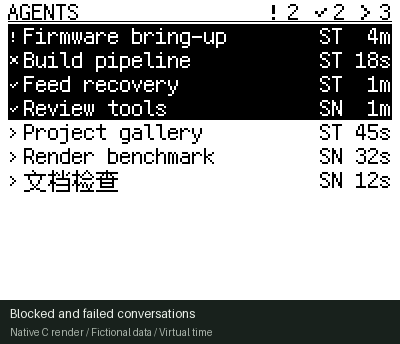
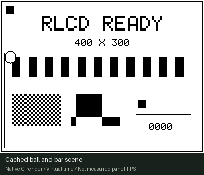

# esp32-rlcd

[](https://github.com/byebyebryan/esp32-rlcd/actions/workflows/checks.yml)

Projects and shared board support for the **Waveshare ESP32-S3-RLCD-4.2**,
built with ESP-IDF and a packed monochrome C renderer.

[Project gallery](#project-gallery) · [Build](#build) · [Hardware](#hardware) · [Development](docs/development.md)

## Project gallery

### Live agent dashboard



A desk view of running Codex conversations across Starship and Snap. Conversation
names, host badges and activity ages sit beside blocked, waiting and working
states. Whole-roster counts include hidden rows; partial/offline views keep
uncertainty visible. A supervised host bridge supplies the real Observer/Mesh feed.

[Project and setup](projects/agent-dashboard/README.md) · [Live operation](projects/agent-dashboard/docs/operations.md) · [Media source](projects/agent-dashboard/docs/media/README.md)

### Rendering benchmark



Compare full redraw, cached drawing, polling SPI and queued DMA using the same
panel path. Recorded board trials reached about **80.8 completed SPI writes/s**;
queued DMA reduced core 0 busy time to roughly **3%** for the cached scene.
The continuous demonstration uses 50 writes/s pacing.

[Project and build](projects/render-bench/README.md) · [Measured findings](projects/render-bench/docs/performance.md) · [Media source](projects/render-bench/docs/media/README.md)

*Previews use production C rendering with virtual time and fictional dashboard
records. They are native renders; playback is separate from measured panel
performance and physical contrast.*

Each application is standalone firmware; one runs on the board at a time. The
root is a hardware workspace with no default ESP-IDF application. All projects
use the shared [display component](components/display_rlcd/README.md).

## Hardware

Built for the [Waveshare ESP32-S3-RLCD-4.2](https://docs.waveshare.com/ESP32-S3-RLCD-4.2):
ESP32-S3, 16 MiB flash, 8 MiB PSRAM and a 4.2-inch, 300 × 400 reflective monochrome
LCD. It uses ambient light and has no backlight. Current applications use
400 × 300 landscape with a 15,000-byte framebuffer and SPI panel transport.

See the [official hardware documentation](https://docs.waveshare.com/ESP32-S3-RLCD-4.2)
for board resources and revision details, and [board support](docs/board.md) for
the implemented pins, transport and firmware scope.

## Build

Follow the [fresh-machine setup guide](docs/setup.md), then run from the repository
root. The toolchain is pinned to ESP-IDF v5.5.3:

```sh
./scripts/setup.sh
./scripts/idf.sh --version
./scripts/idf.sh -C projects/agent-dashboard build
# or: ./scripts/idf.sh -C projects/render-bench build
# or: ./scripts/idf.sh -C projects/bringup build
```

For interactive ESP-IDF commands:

```sh
. scripts/env.sh
idf.py -C projects/agent-dashboard menuconfig
```

Follow the selected project's guide for flashing and host dependencies. Identify
the exact board using its stable USB serial path; flashing replaces its firmware.
Each project owns its generated `sdkconfig` and `build/` output.

## Documentation

- [Development](docs/development.md): application boundaries, native checks and adding a project.
- [Setup](docs/setup.md): toolchain installation, USB access and troubleshooting.
- [Bring-up diagnostics](projects/bringup/README.md): panel orientation, pixel packing, memory and USB checks.
- [Shared display component](components/display_rlcd/README.md): packing, transport and upstream provenance.
- [Presentation media](docs/media/README.md): gallery sources, regeneration and capture guidance.
- [Dashboard operation](projects/agent-dashboard/docs/operations.md): managed services, runtime selection and rollback.
- [Latest host rollout](projects/agent-dashboard/docs/evidence/2026-10-20-restart-context/REPORT.md): restart recovery and both-device checks; firmware and installed package identities are retained separately.
- [Workspace history](docs/workspace-origin.md): earlier layout and migration context.

Dated [evidence records](docs/evidence/) retain the source paths, artifacts and
acceptance scope from their capture time.
