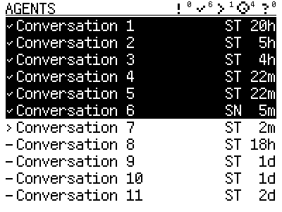
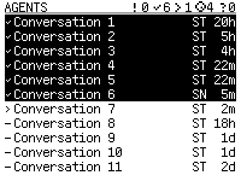

# Working-set header readability

The wire-3 renderer accidentally selected the compact 12-pixel count font for
all supplied working-set totals. Its icons and title retained the larger size,
making the header counts look like small superscripts. Runtime source
`29fe5b441270c8dc8aac5a1ca33f55ee39e929ec` restores the same 24-pixel font used
by the title and conversation rows. Five totals, capped `99+` values and `+99+`
overflow still fit; the title abbreviates when necessary.

| Previous header | Corrected header |
| --- | --- |
|  |  |

These are native renders with anonymized conversation labels, not panel photos.
The input is identical and every body pixel below the header remains exact.
The normal and all-five-capped-plus-overflow cases were inspected at 400 × 300.

The old renderer fails the new full-size digit assertion. The corrected renderer
passes packed-frame, bounds, animation and UTF-8 checks, plus all 71 dashboard
checks without skips against the installed package pair. Host data, membership,
leases, counts and wire version are unchanged by the firmware correction.

Snap board `94:a9:90:de:d0:04` was identified independently and its complete
16 MiB flash was backed up before writing only the application. Readback of the
application matches the pinned build; original bootloader and partition bytes
remain exact. The existing host bundle and package pair remain selected. The
bridge restarted with fresh device ACKs, ten healthy rows and no missed frames.
Observer, all Agent publishers and 349 service incarnations remain unchanged;
Starship's device was untouched. Manual panel and reboot acceptance remain
separate from readback and ACK evidence.

[Receipt](receipt.json) records exact build/readback/backup hashes and diagnostics.
The full backup and raw logs remain outside Git under Snap's
`~/.local/state/rlcd-header-fix-20261019/`. The newly built bootloader was not
flashed; the receipt distinguishes it from the original retained bootloader.
Source and configuration commits are local, without a GitHub push.
