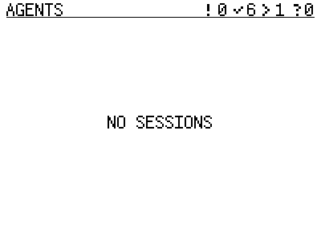

# Header without a recent counter

At Bryan's request, firmware source
`df89736842857dc0606775ffaf4cf92b63284339` removes the clock/recent count from
the header. Attention, ready, working and uncertain retain the 24-pixel font.
Recent conversations remain in the list with unchanged membership, sorting,
expiry, feed accounting and whole-roster capacity behavior. The wire and
selected host bundle/package pair are unchanged.

The renderer test varies only the hidden recent total from 4 to 500 and requires
an identical frame, then varies uncertainty and requires a changed header. It
also checks normal and capped counts/overflow at the readable font size. Motion
checks and all 71 dashboard checks pass, without skips. Presentation media were
regenerated and documentation source/asset pins pass.

The [receipt](receipt.json) records exact Snap application readback, current-image
rollback capture, retained complete flash backup, protected service incarnations
and device acknowledgements. The screenshot is a native render, not a panel photo.
