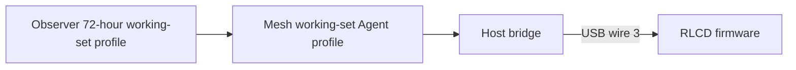

# Live agent dashboard


Show loaded Codex conversations across Starship and Snap. Only sessions with
current running-runtime evidence enter the list, including loaded idle/ready
sessions. Unloaded recent history is excluded. Blocked rows flash slowly,
waiting rows stay inverse, and working rows remain normal. When evidence expires,
work styling and ages clear while uncertain context for previously loaded
sessions remains. Healthy hosts stay useful during a sibling outage.

[Operate the live feed](docs/operations.md) · [Integration contract](docs/live-integration.md) · [Presentation media](docs/media/README.md)

## Display behavior

The 400 × 300 monochrome view has eleven 24-pixel rows. Whole-roster counts include
hidden loaded conversations; the bridge transports up to 32 rows. Titles use
project/cwd fallbacks and rendered collision handling. Confirmed child, system
and unloaded rows are excluded. The header shows attention, ready, working and
uncertain counts. A current running session with a current waiting phase gets
the ready check; a completed historical turn cannot establish readiness.

Ages mean source-sampled time since conversation activity. They do not measure
how long a conversation has been blocked or waiting. PARTIAL and FEED OFFLINE
qualify source loss, and expired observations cannot retain current work claims.

The generic native active demo uses fictional records and virtual time. It shows
answered waits, row movement, one-host loss, feed expiry and recovery. Its
current wire 3 images exercise admission and rendering, but contain no
recent-only members; the working-set behavior is defined in the
[integration contract](docs/live-integration.md).


## Data and runtime



Observer owns native discovery and classification. Mesh owns validated delivery
and freshness. Observer applies the fixed eligible active-or-recent selector
before transport. The bridge reconciles scoped membership, names and five totals;
firmware owns packet admission, expiry, layout and animation. This application
performs no provider actions. The [live contract](docs/live-integration.md)
defines the boundaries.

Starship and Snap each run a boot-enabled user service from a verified host bundle. It
supervises subscription/serial workers, recovers from USB absence or disconnection,
and keeps routine diagnostics quiet. The [release receipt](../../docs/evidence/2026-10-13-release-refinement/REPORT.md)
records published source, installed runtime, checks and exercised rollback.
Names, host badges and activity ages have [physical readability acceptance](../../docs/evidence/2026-10-13-dashboard-refinement/REPORT.md).
Manual panel/reboot follow-ups remain deferred.
The [helper and failure refinement plan](docs/failure-refinement-plan.md) covers
the observed title-helper rows and model-capacity failure presentation. Its
[acceptance receipt](../../docs/evidence/2026-10-14-failure-refinement/REPORT.md)
records independent producer and paired device rollout. Known
current failed turns in active sessions use an error cross and contribute to `!`
attention counts. Unloaded sessions are excluded, including those whose last
turn failed.
A fresh active turn clears the preceding failure; unsupported observations keep `?`.

The [owned admission checkpoint](../../docs/evidence/2026-10-15-owned-admission/REPORT.md)
adopts Observer a6/Mesh a22 with selected current bodies and complete membership
summaries. Strict admission, per-row expiry, diagnostics and display policy remain.
The [active-session feed plan](docs/active-feed-plan.md) records the earlier
active-only contract. The current bridge default uses Observer a7 / Mesh a23's
explicit working-set profile and public membership leases, with a loaded-only
consumer filter; full history remains an explicit diagnostic. The [active-feed receipt](../../docs/evidence/2026-10-16-active-feed/REPORT.md)
records the prior wire 2 rollout and paired rollback. Physical
ACK/readability/reboot gates remain separate.
The [Snap synchronization receipt](../../docs/evidence/2026-10-19-snap-sync/REPORT.md)
records that earlier rollout's firmware readback, managed service and bounded
physical ACK/expiry checks; its Starship native-source limitation describes the
state at the time of that receipt.

The [working-set adoption receipt](../../docs/evidence/2026-10-19-working-set-adoption/REPORT.md)
records the initial Snap wire-3 client/firmware, exact private package pair,
both-host native comparisons, live expiry/recovery, and exercised paired rollback.
The [Starship synchronization receipt](../../docs/evidence/2026-10-19-starship-sync/REPORT.md)
records its later move to the same verified host bundle and firmware components.
Both devices now use wire 3. Whole-producer and manual panel/reboot acceptance
remain distinct from these scoped deployments.

An earlier Snap refinement showed [terminal results for unloaded threads](../../docs/evidence/2026-10-19-recent-status/REPORT.md),
restored [readable header numbers](../../docs/evidence/2026-10-19-header-readability/REPORT.md),
and [removed the separate recent counter](../../docs/evidence/2026-10-19-remove-recent-count/REPORT.md)
while retaining recent conversations in the list at that time. The subsequent
[neutral-status correction](../../docs/evidence/2026-10-19-inactive-status/REPORT.md)
preceded the current [loaded-only selection](../../docs/evidence/2026-10-19-loaded-only/REPORT.md),
which excludes unloaded history.
Each receipt preserves its
original source, firmware and deployment evidence.

## Build and check

After [toolchain setup](../../docs/setup.md), run from the repository root:

```sh
./scripts/idf.sh -C projects/agent-dashboard build
./projects/agent-dashboard/scripts/test-live-dashboard.sh
./projects/agent-dashboard/scripts/test-dashboard-motion.sh
```

The firmware defaults to the live USB feed. Building it does not install the host
bridge. Follow [operation and deployment](docs/operations.md) for the accepted
Observer/Mesh environment, cached roster inspection, exclusive serial ownership,
service maintenance and bounded captures.

Native checks use a host C compiler and Python's standard library. Regenerate the
gallery with the optional Pillow authoring environment described in the
[media guide](docs/media/README.md).

## Retained studies

The [synthetic study guide](docs/synthetic-studies.md) keeps earlier static and
motion modes, comparison previews, menuconfig choices and capture commands.
These are separate from the default live feed. The [UI study](docs/ui-study.md),
[accepted row styles](docs/flashing-rows-study.md) and
[icon-count header](docs/icon-counts-study.md) preserve the design history.
