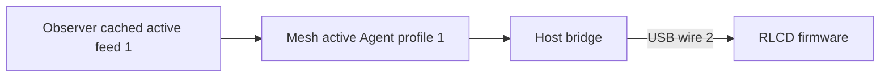

# Live agent dashboard


Keep running Codex conversations visible across Starship and Snap. Blocked rows
flash slowly, waiting rows stay inverse, and working rows remain normal. Useful
conversation titles lead; host badges and activity ages keep the roster compact.
When evidence expires, work styling and ages clear while uncertain identity
context remains. Healthy hosts remain useful during a sibling outage.

[Operate the live feed](docs/operations.md) · [Integration contract](docs/live-integration.md) · [Presentation media](docs/media/README.md)

## Display behavior

The 400 × 300 monochrome view has eleven 24-pixel rows. Whole-roster counts include
hidden conversations; the bridge transports up to 32 rows. Titles use project/cwd
fallbacks and rendered collision handling. Known children, system helpers and
parked sessions are excluded; running sessions of unknown kind remain eligible.

Ages mean source-sampled time since conversation activity. They do not measure
how long a conversation has been blocked or waiting. PARTIAL and FEED OFFLINE
qualify source loss, and expired observations cannot retain current work claims.

The following native story uses fictional records and virtual time. It exercises
answered waits, row movement, one-host loss, feed expiry and recovery through the
same projection, wire admission and C renderer as the live application.


## Data and runtime



Observer owns native discovery and classification. Mesh owns validated delivery
and freshness. Observer applies the fixed running-conversation selector before
transport. The bridge reconciles scoped membership, names and counts; firmware owns packet
admission, expiry, layout and animation. This application performs no provider
actions. The [live contract](docs/live-integration.md) defines the boundaries.

Starship runs a boot-enabled user service from a verified host bundle. It
supervises subscription/serial workers, recovers from USB absence or disconnection,
and keeps routine diagnostics quiet. The [release receipt](../../docs/evidence/2026-10-13-release-refinement/REPORT.md)
records published source, installed runtime, checks and exercised rollback.
Names, host badges and activity ages have [physical readability acceptance](../../docs/evidence/2026-10-13-dashboard-refinement/REPORT.md).
Manual panel/reboot follow-ups remain deferred.
The [helper and failure refinement plan](docs/failure-refinement-plan.md) covers
the observed title-helper rows and model-capacity failure presentation. Its
[acceptance receipt](../../docs/evidence/2026-10-14-failure-refinement/REPORT.md)
records independent producer and paired device rollout. Known
current failed turns use an error cross and contribute to `!` attention counts.
A fresh active turn clears the preceding failure; unsupported observations keep `?`.

The [owned admission checkpoint](../../docs/evidence/2026-10-15-owned-admission/REPORT.md)
adopts Observer a6/Mesh a22 with selected current bodies and complete membership
summaries. Strict admission, per-row expiry, diagnostics and display policy remain.
The [active-session feed plan](docs/active-feed-plan.md) now selects Observer a7 /
Mesh a23: selection and its cache live before service IPC, while the full inventory
remains available for diagnostics. The [active-feed receipt](../../docs/evidence/2026-10-16-active-feed/REPORT.md)
records exact artifacts, scoped retirement, matched scaling, live service cost
and paired rollback. Physical ACK/readability/reboot gates remain separate.

## Build and check

After [toolchain setup](../../docs/setup.md), run from the repository root:

```sh
./scripts/idf.sh -C projects/agent-dashboard build
./projects/agent-dashboard/scripts/test-live-dashboard.sh
./projects/agent-dashboard/scripts/test-dashboard-motion.sh
```

The firmware defaults to the live USB feed. Building it does not install the host
bridge. Follow [operation and deployment](docs/operations.md) for the accepted
Observer/Mesh environment, cached roster inspection, exclusive serial ownership,
service maintenance and bounded captures.

Native checks use a host C compiler and Python's standard library. Regenerate the
gallery with the optional Pillow authoring environment described in the
[media guide](docs/media/README.md).

## Retained studies

The [synthetic study guide](docs/synthetic-studies.md) keeps earlier static and
motion modes, comparison previews, menuconfig choices and capture commands.
These are separate from the default live feed. The [UI study](docs/ui-study.md),
[accepted row styles](docs/flashing-rows-study.md) and
[icon-count header](docs/icon-counts-study.md) preserve the design history.
